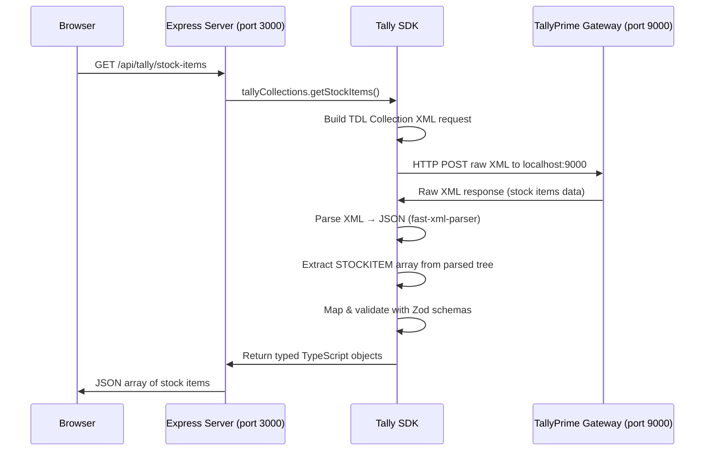

# How We Fetch Stock Items from Tally — Complete Guide

## The Big Picture



---

## Step-by-Step: What Happens When You Hit `/api/tally/stock-items`

### Step 1 — Route matches the request

File: [tally.routes.ts](file:///e:/Tally-Data/src/routes/tally.routes.ts)

```typescript
router.get('/stock-items', TallyController.getStockItems);
```

Express matches the URL and calls the controller.

---

### Step 2 — Controller calls the SDK

File: [tally.controller.ts](file:///e:/Tally-Data/src/controllers/tally.controller.ts#L79-L86)

```typescript
static async getStockItems(req: Request, res: Response) {
  const data = await tallyCollections.getStockItems();
  return res.json(data);
}
```

The controller doesn't know or care about XML. It just calls `getStockItems()` and returns JSON.

---

### Step 3 — SDK builds the XML request

File: [requests.ts](file:///e:/Tally-Data/src/sdk/tally/requests.ts)

This is the **most critical part**. Tally's XML API requires a very specific format called **TDL Collection Export**:

```xml
<ENVELOPE>
  <HEADER>
    <VERSION>1</VERSION>
    <TALLYREQUEST>Export</TALLYREQUEST>    <!-- Must be "Export", NOT "Export Data" -->
    <TYPE>Collection</TYPE>                <!-- Must be "Collection" -->
    <ID>StockItemCollection</ID>           <!-- Any unique name for this collection -->
  </HEADER>
  <BODY>
    <DESC>
      <STATICVARIABLES>
        <SVEXPORTFORMAT>$$SysName:XML</SVEXPORTFORMAT>  <!-- Forces XML output -->
      </STATICVARIABLES>
      <TDL>
        <TDLMESSAGE>
          <COLLECTION NAME="StockItemCollection" ISMODIFY="No">
            <TYPE>Stock Item</TYPE>        <!-- The Tally object type (with space!) -->
            <FETCH>NAME, PARENT, BASEUNITS, OPENINGBALANCE, ...</FETCH>
          </COLLECTION>
        </TDLMESSAGE>
      </TDL>
    </DESC>
  </BODY>
</ENVELOPE>
```

> [!IMPORTANT]
> **The `<TYPE>` must be `Stock Item` (with a space), not `StockItem`.** Tally uses spaced names internally for its object types. Other types include `Stock Group`, `Stock Category`, `Ledger`, `Voucher`, `Company`, `Unit`.

> [!WARNING]
> **Do NOT use `<TALLYREQUEST>Export Data</TALLYREQUEST>` with `<REPORTNAME>List of Accounts</REPORTNAME>`.** That format only works for accounting masters (Ledger, Group) — for Stock Items it returns garbage (an `IMPORTDATA` echo of the last import).

---

### Step 4 — SDK sends the XML via HTTP POST

File: [client.ts](file:///e:/Tally-Data/src/sdk/tally/client.ts)

```typescript
const response = await axios.post('http://localhost:9000', xmlString, {
  headers: { 'Content-Type': 'text/xml' },
  responseType: 'text',
});
```

Key points:
- TallyPrime runs a **built-in HTTP server** on port **9000** by default
- You POST raw XML as the request body
- Tally responds with raw XML
- There are **no REST endpoints**, no auth tokens, no API keys — just one URL that accepts XML

---

### Step 5 — Tally responds with XML

Tally returns XML like this:

```xml
<ENVELOPE>
 <HEADER>
  <VERSION>1</VERSION>
  <STATUS>1</STATUS>               <!-- 1 = success -->
 </HEADER>
 <BODY>
  <DESC>...</DESC>                  <!-- Company metadata (can be ignored) -->
  <DATA>
   <COLLECTION ISMSTDEPTYPE="Yes">
    <STOCKITEM NAME="Samsung S25 Ultra" RESERVEDNAME="">
     <PARENT TYPE="String">Electronics</PARENT>
     <BASEUNITS TYPE="String">Nos</BASEUNITS>
     <CLOSINGBALANCE TYPE="Quantity"> 8 Nos</CLOSINGBALANCE>
     <OPENINGVALUE TYPE="Amount">0.00</OPENINGVALUE>
     <CLOSINGVALUE TYPE="Amount">-520000.00</CLOSINGVALUE>
     <CLOSINGRATE TYPE="Rate">65000.00/Nos</CLOSINGRATE>
    </STOCKITEM>
    <STOCKITEM NAME="Apple 20W Charger" ...>
     ...
    </STOCKITEM>
   </COLLECTION>
  </DATA>
 </BODY>
</ENVELOPE>
```

The data lives at: **`ENVELOPE → BODY → DATA → COLLECTION → STOCKITEM[]`**

> [!IMPORTANT]
> **Every field has a `TYPE` attribute** (e.g., `<PARENT TYPE="String">Electronics</PARENT>`). This means `fast-xml-parser` with `ignoreAttributes: false` will parse `PARENT` as `{ "#text": "Electronics", "@_TYPE": "String" }` instead of just `"Electronics"`. You **must** handle this.

---

### Step 6 — SDK parses the XML

File: [parser.ts](file:///e:/Tally-Data/src/sdk/tally/parser.ts)

```typescript
const parser = new XMLParser({
  ignoreAttributes: false,       // Keep attributes (Tally uses them heavily)
  attributeNamePrefix: '@_',     // Prefix attributes with @_
  textNodeName: '#text',         // Text content accessible via #text
  parseTagValue: true,           // Auto-parse numbers
  trimValues: true,
  isArray: (name) => {           // Force these to always be arrays
    return ['STOCKITEM', 'LEDGER', 'VOUCHER', ...].includes(name);
  }
});
```

The `isArray` config is critical — if Tally returns only 1 stock item, `fast-xml-parser` would return it as an object instead of an array. This forces it to always be an array.

---

### Step 7 — SDK extracts the collection

File: [parser.ts](file:///e:/Tally-Data/src/sdk/tally/parser.ts) → `extractCollection()`

```typescript
const data = parsed?.ENVELOPE?.BODY?.DATA?.COLLECTION;
const items = data['STOCKITEM'];  // Always an array thanks to isArray config
```

---

### Step 8 — SDK maps fields using getValue()

File: [collections.ts](file:///e:/Tally-Data/src/sdk/tally/collections.ts)

Because of Tally's `TYPE` attributes, we need the `getValue()` helper:

```typescript
// Tally returns: { "#text": "Accessories", "@_TYPE": "String" }
// getValue() extracts: "Accessories"
const getValue = (val: any, fallback = ''): string => {
  if (typeof val === 'object' && val !== null) {
    return String(val['#text'] ?? fallback);
  }
  return String(val ?? fallback);
};

// Usage:
const data = {
  name: item['@_NAME'] || getValue(item['NAME']),   // Name is in the attribute
  group: getValue(item['PARENT']),                    // "Accessories"
  unit: getValue(item['BASEUNITS']),                  // "Nos"
  closingQty: parseNumber(item['CLOSINGBALANCE']),    // 8
};
```

---

### Step 9 — Zod validates the output

File: [tally.validators.ts](file:///e:/Tally-Data/src/validators/tally.validators.ts)

```typescript
const tallyStockItemSchema = z.object({
  name: z.string(),
  group: z.string(),
  unit: z.string(),
  closingQty: z.number(),
  openingQty: z.number(),
  rate: z.number(),
  value: z.number(),
});
```

This ensures every stock item has the correct shape before it leaves the SDK.

---

## How to Replicate This in Another Project

### Prerequisites
- TallyPrime must be running with its **Gateway Server** enabled (port 9000)
- Node.js installed

### Step-by-step

```bash
# 1. Create project
mkdir my-tally-app && cd my-tally-app
npm init -y

# 2. Install dependencies
npm install express axios fast-xml-parser zod dotenv
npm install -D typescript tsx @types/express @types/node

# 3. Create tsconfig.json
npx tsc --init
```

### 3. Create the Tally client

```typescript
// src/tally-client.ts
import axios from 'axios';

export async function queryTally(xml: string): Promise<string> {
  const response = await axios.post('http://localhost:9000', xml, {
    headers: { 'Content-Type': 'text/xml' },
    responseType: 'text',
    timeout: 15000,
  });
  return response.data;
}
```

### 4. Build the XML request

```typescript
// src/tally-requests.ts
export function fetchStockItems(): string {
  return `<ENVELOPE>
  <HEADER>
    <VERSION>1</VERSION>
    <TALLYREQUEST>Export</TALLYREQUEST>
    <TYPE>Collection</TYPE>
    <ID>StockItemCollection</ID>
  </HEADER>
  <BODY>
    <DESC>
      <STATICVARIABLES>
        <SVEXPORTFORMAT>$$SysName:XML</SVEXPORTFORMAT>
      </STATICVARIABLES>
      <TDL>
        <TDLMESSAGE>
          <COLLECTION NAME="StockItemCollection" ISMODIFY="No">
            <TYPE>Stock Item</TYPE>
            <FETCH>NAME, PARENT, BASEUNITS, CLOSINGBALANCE, CLOSINGVALUE</FETCH>
          </COLLECTION>
        </TDLMESSAGE>
      </TDL>
    </DESC>
  </BODY>
</ENVELOPE>`;
}
```

### 5. Parse the response

```typescript
// src/tally-parser.ts
import { XMLParser } from 'fast-xml-parser';

const parser = new XMLParser({
  ignoreAttributes: false,
  attributeNamePrefix: '@_',
  textNodeName: '#text',
  parseTagValue: true,
  trimValues: true,
  isArray: (name) => ['STOCKITEM'].includes(name),
});

// Extract plain text from Tally's attribute-decorated nodes
function getValue(val: any, fallback = ''): string {
  if (val === undefined || val === null) return fallback;
  if (typeof val === 'object') return String(val['#text'] ?? fallback);
  return String(val);
}

function parseNumber(val: any): number {
  const raw = typeof val === 'object' ? val?.['#text'] : val;
  if (!raw) return 0;
  const num = parseFloat(String(raw).replace(/[^0-9.-]+/g, ''));
  return isNaN(num) ? 0 : Math.abs(num);
}

export function parseStockItems(xml: string) {
  const parsed = parser.parse(xml);
  const items = parsed?.ENVELOPE?.BODY?.DATA?.COLLECTION?.STOCKITEM ?? [];

  return items.map((item: any) => ({
    name: item['@_NAME'] || getValue(item['NAME']),
    group: getValue(item['PARENT']),
    unit: getValue(item['BASEUNITS']),
    closingQty: parseNumber(item['CLOSINGBALANCE']),
    closingValue: parseNumber(item['CLOSINGVALUE']),
  }));
}
```

### 6. Wire it together

```typescript
// src/index.ts
import { queryTally } from './tally-client';
import { fetchStockItems } from './tally-requests';
import { parseStockItems } from './tally-parser';

async function main() {
  const xml = fetchStockItems();
  const rawResponse = await queryTally(xml);
  const stockItems = parseStockItems(rawResponse);
  console.log(JSON.stringify(stockItems, null, 2));
}

main();
```

### 7. Run it

```bash
npx tsx src/index.ts
```

---

## Common Tally TDL Collection Types

| Collection Name (for `<TYPE>`) | What it fetches |
|------|------|
| `Stock Item` | Inventory items |
| `Stock Group` | Stock item groups/categories |
| `Stock Category` | Stock categories |
| `Ledger` | All ledger accounts |
| `Group` | Ledger groups (e.g., Sundry Debtors) |
| `Voucher` | All vouchers (sales, purchases, etc.) |
| `Company` | Company info |
| `Unit` | Units of measurement |
| `Cost Centre` | Cost centres |
| `Godown` | Godowns/warehouses |
| `Currency` | Currency definitions |

## Common Pitfalls

| Pitfall | Solution |
|---------|----------|
| Using `Export Data` instead of `Export` | Use `<TALLYREQUEST>Export</TALLYREQUEST>` with `<TYPE>Collection</TYPE>` |
| Using `StockItem` (no space) in `<TYPE>` | Use `Stock Item` (with space) |
| Fields returning objects instead of strings | Use `getValue()` to extract `#text` from attribute-decorated nodes |
| Single item returned as object, not array | Use `isArray` config in `fast-xml-parser` |
| Stale `.js` files shadowing `.ts` sources | Delete compiled files; use `tsx` directly |
| Tally not responding | Ensure TallyPrime is open with a company loaded and Gateway Server is enabled on port 9000 |
